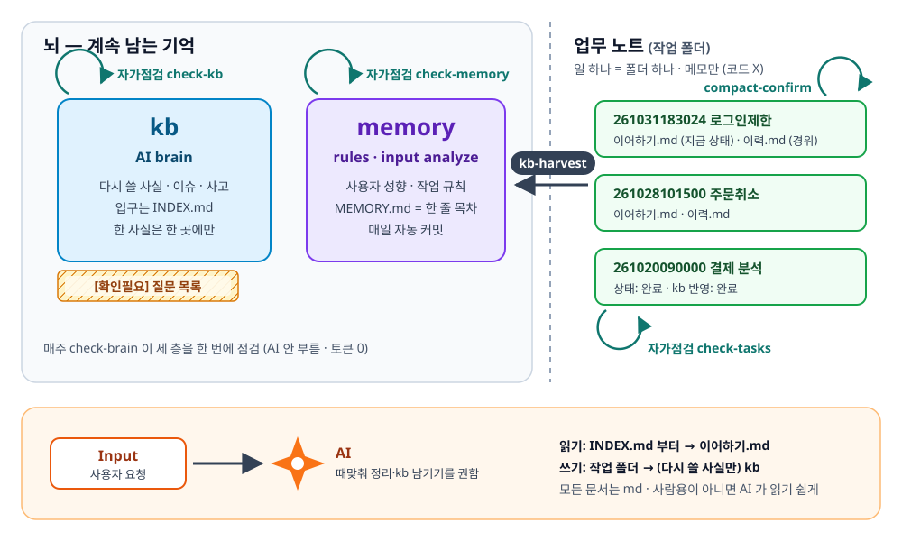

# keep-ai-brain

**AI 의 기억을 파일에 남기고, 커져도 썩지 않게 지키는 방법 + 도구.**

AI 랑 몇 달째 같은 프로젝트를 하고 있는데, 문서가 쌓일수록 AI 가 헷갈리기 시작했다면 — 이건 그 문제를 실제로 겪고 하나씩 막아 온 기록이에요.



## 이런 분께

- AI(Claude Code)와 **같은 코드베이스를 몇 주, 몇 달째** 작업하는 분
- 세션이 바뀔 때마다 **같은 설명을 또 하고 있는** 분
- AI 에게 메모를 남기게 했더니 **메모가 수백 개로 늘어 오히려 AI 가 헷갈리는** 분
- AI 가 만든 코드를 **같은 AI 가 검토해서 놓치는 게 불안한** 분

토이프로젝트 한두 개라면 이 정도까진 필요 없을 수 있어요. 기억할 게 적으니까요.

## 무엇이 다른가

AI 메모리 도구는 이미 많아요. 대부분 **"작업 하나를 어떻게 진행하나"** 를 다뤄요 (계획 → 구현 → 회고).

keep-ai-brain 은 그다음 문제를 다뤄요. **"몇 달 쌓인 지식이 어떻게 안 썩게 하나."**

| 커지면 생기는 일 | keep-ai-brain 이 하는 것 |
|---|---|
| 같은 내용이 두 문서에 있고 한쪽만 고쳐짐 | 한 사실은 한 곳에만 + 점검기가 깨진 링크를 잡음 |
| 문서가 너무 커서 AI 가 앞부분만 읽음 | 문서 50KB · 목차 한 줄 150자 제한, 넘으면 점검기가 경고 |
| "확인 필요" 메모가 수백 개 흩어져 아무도 안 봄 | 자동으로 질문 목록 한 장에 모음 |
| 이어하기 메모가 경위까지 쌓여 지금 상태가 안 보임 | 지금 상태(덮어쓰기)와 경위(쌓기)를 두 파일로 |
| 끝난 일이 "진행 중" 으로 남아 다음 세션이 믿음 | 작업 폴더·메모리 점검기가 낡은 것을 찾음 |
| 규칙을 md 에 써도 AI 가 가끔 어김 | 위험한 건 hook 이 실행 직전에 막음 |

모든 규칙에는 **그 규칙이 생긴 실제 사고**가 있어요 → [docs/why.md](docs/why.md)

## 기억 3층

| 층 | 담는 것 | 수명 | 지키는 도구 |
|---|---|---|---|
| **kb** | 다시 쓸 사실 — 코드·DB 로 확인한 동작, 이슈, 사고, 업무 뜻 | 계속, 커지는 곳 | `check-kb` · 질문 목록 · 이슈 대장 |
| **memory** | 사용자 성향, 작업 규칙 | 계속 | `check-memory` · 매일 자동 커밋 |
| **작업 폴더** (업무 노트) | 일 하나 = 폴더 하나. `이어하기.md`(지금 상태) · `이력.md`(경위) | 일이 끝날 때까지 | `check-tasks` · `compact-confirm` |

> **작업 폴더는 코드 저장소가 아니에요.** 코드는 원래 저장소(git)에서 고치고, 작업 폴더에는 그 일에 대한 **메모**(이어하기, 이력, 기준표, 검토 보고서)만 둬요. 메모가 커밋에 섞이지 않게 프로젝트 저장소 **밖**에 둬요.

정보는 스킬을 타고 층 사이를 옮겨 다녀요. 대화 → 작업 폴더는 `/compact-confirm`, 작업 폴더 → kb 는 `/kb-harvest`.

일 하나를 끝낸 뒤의 모습이에요. 코드는 원래 저장소에 그대로 있고, brain 은 그 옆에서 기억만 맡아요.

```text
~/projects/my-app/                  ← 코드 (원래 git 저장소). 개발·커밋·push 는 여기서
~/brain/
├── kb/                             ← 계속 쌓이는 사실. 여러 프로젝트 공용 · 로컬 git
│   ├── INDEX.md                    ← 입구. 문서마다 한 줄 안내
│   ├── overview/  patterns/  ops/
│   ├── trouble/windows-ps-pipe.md  ← /kb-harvest 가 새로 만든 함정 기록
│   └── _tools/                     ← 점검 도구 · reports/latest.md (주간 리포트)
└── tasks/                          ← 업무 노트 · git 아님
    └── 261031143000my-app-통계설명/
        ├── 이어하기.md              ← 지금 상태만 (대상 저장소: ~/projects/my-app)
        └── 이력.md                  ← 경위
~/.claude/projects/…/memory/        ← MEMORY.md(한 줄 목차) + 메모리 하나 = 파일 하나 · 로컬 git
```

같은 일을 대화 순서로 따라가 보려면 → [docs/example.md](docs/example.md)

## 들어 있는 것

| 폴더 | 내용 |
|---|---|
| `skills/` | **consult** 질문 먼저 · **kb-harvest** 대화에서 kb 로 · **compact-confirm** compact 전 점검과 이어하기 · **criteria** 개발 전 판정 기준표 · **critic** 근거 있는 지적만 남기는 비판 검토 |
| `kb-tools/` | `check-brain` (세 층 한 번에) · `check-kb` · `check-memory` · `check-tasks` · `collect-questions` · `collect-issues` |
| `hooks/` | `guard.mjs` — 운영 DB 접속, 보호 폴더 수정 같은 것을 실행 직전에 차단 (막을 대상은 설정 파일로) · `test-guard.cjs` 시험 |
| `templates/` | 빈 kb, CLAUDE.md 블록, 메모리 목차, 이어하기·이력 양식 |
| `scheduler/` | 메모리 매일 자동 커밋, 주간 뇌 점검 리포트 (Windows 작업 스케줄러 · cron) |
| `docs/` | [example.md](docs/example.md) 일 하나를 처음부터 끝까지 · [why.md](docs/why.md) 규칙이 생긴 이유 · [windows-pitfalls.md](docs/windows-pitfalls.md) Windows 에서 조용히 깨지는 것들 |

## 설치

**AI 가 설치해요.** clone 한 뒤 Claude Code 에게 이렇게만 말하세요.

```text
keep-ai-brain 폴더의 SETUP.md 읽고 설치해 줘
```

AI 가 먼저 이 PC 를 점검하고(node·git·기존 설정), 꼭 필요한 것만 물어본 뒤(kb 를 어디에 둘지 등), 기존 설정은 덮어쓰지 않고 합쳐요. 과정은 [SETUP.md](SETUP.md) 에 있어요.

필요한 것: Claude Code, Node.js 18 이상, git

## 하루 흐름

```text
요청 ─▶ /consult        의문이 없어질 때까지 질문 (코드로 알 수 있는 건 AI 가 직접 확인)
       │                "바로 해" 라고 하면 건너뜀
       ▼
       어떻게 진행할까요?  ① ~ ⑤ 전체  /  개발 후 검증만   (AI 가 추천을 같이 냄)
       │
       ├─ 전체: ① /criteria 기준표 → ② 개발 → ③ 전/후 비교 → ④ /critic → ⑤ 사람 확인
       └─ 검증만: ② 개발 → ③ 또는 ④ → ⑤ 사람 확인
       ▼
세션 끝 ─▶ "compact 해도 돼?"
       │   /compact-confirm   이 일의 지금 상태·경위를 작업 폴더에 (이어하기·이력)
       └─▶ /kb-harvest        다른 일에도 쓸 사실이 있으면 kb 로 (커밋까지) — compact-confirm 이 이어서 할지 물어봄
매주   ─▶ check-brain        세 층 자동 점검 → 리포트 (AI 안 부름 · 토큰 0)
```

세션 끝에는 "compact 해도 돼?" 하나만 기억하면 돼요.

| 스킬 | 남기는 것 | 어디에 |
|---|---|---|
| `/compact-confirm` | **이 일**의 지금 상태·다음 할 일·경위 | 작업 폴더 `이어하기.md`·`이력.md` |
| `/kb-harvest` | **다른 일에도** 다시 쓸 사실 — 확인한 동작, 함정, 바로잡은 사실 | kb |

①~⑤ 전체는 토큰과 시간이 많이 들어요. 돈·개인정보·권한·운영 데이터처럼 위험한 일에만 쓰고, 가벼운 일은 검증만 하세요. 그래서 매번 물어봐요.

## 어디서 왔나

- 이전 직장에서 폴더 하나를 "AI 의 뇌" 로 쓰고, [개발] [테스트] [비판적 사고] 세션을 나눠 개발하던 방식에서 시작했어요
- 저장소 10개가 넘는 회사 코드베이스를 AI 와 한 달 반 동안 분석·개발하면서, kb 가 지식 문서 220개·질문 표시 700개 가까이까지 커지는 동안 생긴 사고를 하나씩 규칙과 도구로 바꿨어요
- 회사 코드·데이터는 하나도 들어 있지 않아요. 방법과 도구만 일반화했어요

## 감사

- 기준표(`criteria`) 1장 "의도" 는 Anthropic 「[AI-native SDLC 플레이북](https://claude.com/ko/resources/articles/the-ai-native-sdlc-playbook)」(Louis Claxton, 2026)의 `intent.md` 를 따랐어요

## 라이선스

[MIT](LICENSE) — 자유롭게 쓰고 고치고 회사에서 써도 돼요. 저작권 표시만 남겨 주세요.
